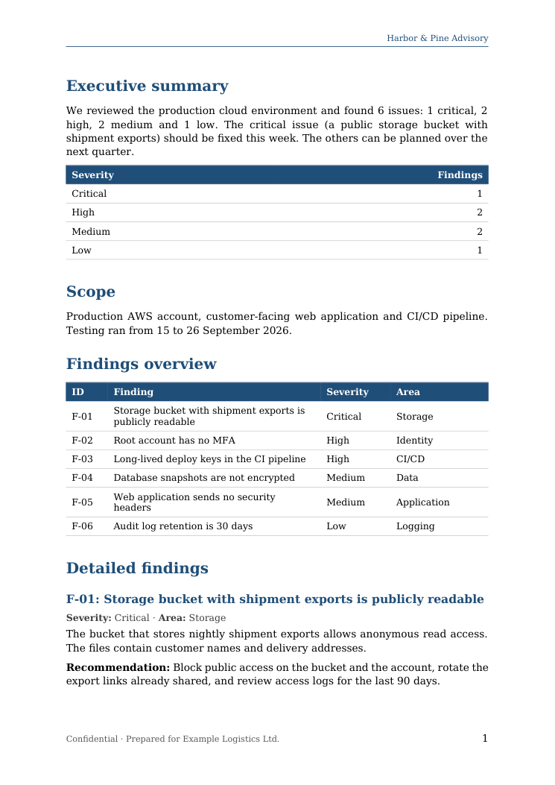

# Branded Word report from JSON

Turns a JSON file of findings into a branded, editable Word report (DOCX) and a PDF with the [Doconda](https://doconda.com) TypeScript SDK.
The report text is built from the JSON in code, with no LLM call; Doconda only lays it out and applies a plain-language style (cover page, company name, heading colour, footer).
The script checks the final status and the style diagnostics, prints warnings, and saves both files to `out/`.

## Requirements

- Node.js 20.12 or newer
- A Doconda API key (create one in the Doconda dashboard under **API keys**). New users get free credit when they sign up at [doconda.com](https://doconda.com).

## Quickstart

1. Clone and install:
   ```bash
   git clone https://github.com/B-C-Software/doconda-examples.git
   cd doconda-examples/typescript/report-from-json
   npm install
   ```
2. Add your key:
   ```bash
   cp .env.example .env   # then set DOCONDA_API_KEY in .env
   ```
   The script loads `.env` itself. Exporting `DOCONDA_API_KEY` in your shell works too.
3. Run it with the bundled findings:
   ```bash
   npm start
   ```
4. Open `out/report.docx` and `out/report.pdf`. To use your own data, pass a JSON file with the same shape as [`sample.json`](sample.json):
   ```bash
   npm start -- my-findings.json
   ```

## Expected output

Real output from a run on 10 October 2026 with `@doconda/sdk` 0.2.0. The files it produced are in [`examples/`](examples): [`report.docx`](examples/report.docx) and [`report.pdf`](examples/report.pdf).

```text
Read 6 findings from sample.json. Markdown saved to out/report.md
Style: Inter 11 pt font, title and headings in #1F4E79, accent #1F4E79, with a cover page and page numbers, in the header: Harbor & Pine Advisory, in the footer: Confidential · Prepared for Example Logistics Ltd.
Creating the document (create waits until it is finished)…
Document doc_01M4JRP14FBNNK1VFYX08X4C8E: status ready_with_warnings, type report, 3 pages
Style applied: Inter 11 pt, headings #1F4E79, accent #1F4E79, cover page yes, page numbers yes
  header: Harbor & Pine Advisory
  footer: Confidential · Prepared for Example Logistics Ltd.

3 warning(s):
  ! Style not applied: Inter no está instalada en este entorno: el render usa una fuente de sustitución, así que la paginación puede variar ligeramente en Word. En el equipo del cliente, el documento necesita tener Inter instalada (o incrustarla) para verse tal cual.
  ! [info] El apartado «Findings overview» no tiene contenido. (page 2)
  ! [warning] Fuentes que no tenemos: Inter. Se sustituyen por otras y la paginación puede variar respecto a Word.

Saved out/report.docx (13.7 KB)
Saved out/report.pdf (66.1 KB)
```

What the warnings mean in this run:

- **Font**: the renderer did not have Inter, so the PDF uses a substitute serif font (DejaVu Serif). The DOCX still names Inter in its styles, so Word shows Inter where it is installed.
- **«Findings overview» has no content**: not true in this output. The section holds the findings table (see page 2 below). Treat `info` issues as hints.
- The messages came back in Spanish in this run.

<p>
  
  
</p>

Anything you ask for that is not applied is printed as a warning before the files are saved: `! Style not applied: …` (from `style_unsupported`), or a mismatch such as `! Headings colour is …, asked for #1F4E79.` (from comparing `style_applied` with the request).

`out/` then contains `report.docx`, `report.pdf` and `report.md` (the exact Markdown that was sent).

| Final status | What the script does | Exit code |
| - | - | - |
| `ready` | Saves both files | 0 |
| `ready_with_warnings` | Prints the report's issues, saves both files | 0 |
| `needs_review` | Prints the report's issues, saves both files, asks you to check them | 0 |
| `failed` | Prints `doc.error` (failed documents are not charged) | 1 |
| `canceled` or anything else | Prints the status | 1 |
| Invalid JSON, missing key, API error (`DocondaError`) | Prints what is wrong (and the request id for API errors) | 1 |

## How to check the result

- **DOCX**: open `out/report.docx` in Word. Change a heading's text and a cell in the *Findings overview* table: check that headings use Word's Heading styles and the table is a real Word table you can edit. Check that the cover page, header, footer and page numbers are there.
- **PDF**: open `out/report.pdf`. Check where pages break, especially around the tables and the detailed findings, and that the footer text and page numbers appear on the content pages.

## Known limits

- Branding is a **style description** in plain language, applied to the Word styles (font, colours, cover page, header, footer, page numbers). It is not an exact replica of your own Word template, and this example does not add a logo.
- Anything Doconda cannot apply comes back in `style_unsupported` and is printed as a warning; the rest is still applied.
- Fonts: the DOCX refers to the font by name, so if the reader does not have Inter installed, Word substitutes a similar one. In the sample run the PDF renderer did not have Inter either and used DejaVu Serif (reported in `style_unsupported`).
- Doconda decides the layout from the Markdown (cover page, page breaks). The text is exactly what `example.ts` builds from your JSON.

## Files

| File | What it is |
| - | - |
| [`example.ts`](example.ts) | Validates the JSON, builds the Markdown and style, creates the document, checks status and style, downloads DOCX and PDF |
| [`sample.json`](sample.json) | Sample findings (a fictional cloud security assessment) |
| [`.env.example`](.env.example) | Template for your `DOCONDA_API_KEY` |
| [`examples/`](examples) | DOCX, PDF and page screenshots from the real run shown above |

`npm run typecheck` type-checks the example. CI ([`typecheck.yml`](../../.github/workflows/typecheck.yml)) runs only that: no API calls, no secrets.

## Docs

- [TypeScript SDK](https://docs.doconda.com/en/sdk/introduction)
- [Create documents](https://docs.doconda.com/en/sdk/create)
- [Style](https://docs.doconda.com/en/guides/style)
- [Errors and retries](https://docs.doconda.com/en/sdk/errors)

Full documentation: [docs.doconda.com](https://docs.doconda.com)

## License

[MIT](../../LICENSE)
